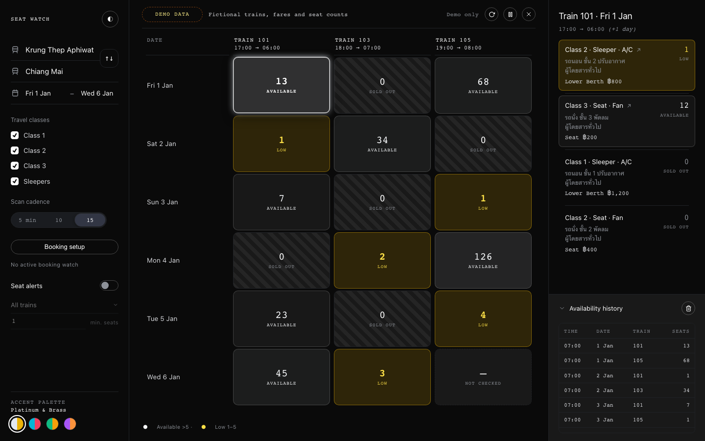

# Railway Seat Watch

A Chrome extension that checks seat availability on [Thai Railway D-Ticket](https://dticket.railway.co.th/DTicketPublicWeb/home/Home). Choose a route, dates, and travel classes, then watch results in one dashboard. It is an independent project and is not affiliated with the State Railway of Thailand.



<p align="center"><em>The screenshot uses an explicitly loaded fictional sample trip.</em></p>

## Install

1. Download and extract the ZIP from the GitHub **Releases** page, or clone the repository.
2. Open `chrome://extensions`.
3. Enable Developer mode.
4. Select Load unpacked and choose the `extension` folder.
5. Open D-Ticket, sign in, and refresh the page.
6. Click Seat dashboard, choose your stations and dates, then click Check now.

All travel classes start checked. The extension saves the settings you choose in Chrome.

## Features

- Search multiple dates and travel classes in one dashboard.
- View coach descriptions, seat counts, and fares. Available coaches sort by seat count, class, and A/C before fan.
- Check availability every 5, 10, or 15 minutes while the dashboard stays open.
- Set seat alerts for selected trains and a minimum seat count.
- Watch multiple train and coach choices. Open one booking when a selected coach has enough fresh seats for the group.
- Set up one-way or round-trip bookings and review passenger details on D-Ticket before paying.
- Review earlier low seat counts in availability history.

Keep Chrome, the railway tab, and the dashboard open for automatic checks.

See the [dashboard guide](extension/README.md) for booking, alerts, history, and troubleshooting. D-Ticket assigns seats and handles payment. Availability checks do not reserve seats, and counts can change before booking.

## Privacy

The extension stores routes, dates, preferences, passenger details you enter, and availability history in Chrome. Account-holder details stay in D-Ticket's session. Passenger details are not included in booking URLs. The extension does not export login cookies or session tokens. Availability requests go directly to D-Ticket. It makes no third-party font or analytics requests. The extension does not encrypt its local storage. See [SECURITY.md](SECURITY.md) for data boundaries, removal steps, and vulnerability reporting.

The public demo contains fictional trips, fares, and seat counts. The repository contains no saved user settings or real trip searches.

## Run the demo

Use Python 3 to start the demo server:

```sh
python3 -m http.server 4371
```

Open [the dashboard demo](http://localhost:4371/dashboard.html). It uses the same controls as the extension and displays Demo data. Settings survive reloads. Booking and native notifications require the installed extension.

The demo starts with empty route and date inputs. Open `dashboard.html?sample=1` to load a fictional sample trip, or `dashboard.html?route=reverse` to view the other direction. Routes or dates outside the demo fixture show no sample results.

## Develop

Use Node.js 24 and Python 3.10 or later. Install the pinned development tools as described in [CONTRIBUTING.md](CONTRIBUTING.md), then run:

```sh
npm run format
npm run check
```

The checks lint and format the sources, regenerate the shared UI and demo data, build `railway-seat-watch-extension.zip`, run the tests, verify startup from the ZIP, and exercise the dashboard in Chromium. The archive includes the MIT license and excludes demo fixtures and local files. Reload the extension and refresh D-Ticket after a change.

## License

[MIT](LICENSE) for the project code and original assets. Contributions use the same license. The demo includes factual station names sourced from D-Ticket. The project license does not grant rights to third-party railway branding or content.
